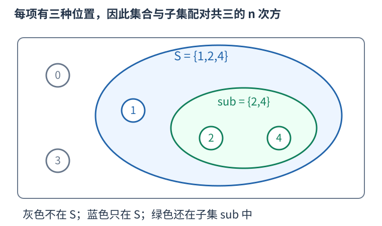

# 子集枚举：只走大集合里允许出现的二进制位

集合S用掩码表示后，枚举其中一个元素与枚举S的一个完整子集是两种不同动作。例如S包含编号一、二、四，子集可以是空集、只选二、选一四、三者全选等，共八种，不能只反复删一个固定元素来代替。



枚举S的全部非空子集，可以从S本身开始，每次更新为 `(sub-1)&S`。减一会把最右的一改零、更低位改一；再与S按位与，只保留大集合允许的位置，恰好得到数值上紧接着的较小合法子集。

```cpp
#include <iostream>
#include <vector>
using namespace std;
int main() {
    unsigned mask = 0b10110; // 集合 {1,2,4}。
    vector<unsigned> subsets;
    for (unsigned sub = mask; sub; sub = (sub - 1) & mask) {
        subsets.push_back(sub);
    }
    subsets.push_back(0); // 空集单独处理一次。
    for (unsigned sub : subsets) cout << sub << ' ';
    cout << '\n';
    unsigned low = mask & -mask;
    int pairs = 0;
    for (unsigned s = 0; s < 8; ++s) {
        ++pairs; // (s, 空集)。
        for (unsigned sub = s; sub; sub = (sub - 1) & s) ++pairs;
    }
    cout << low << ' ' << pairs << '\n';
}
```

第一行依次输出二十二、二十、十八、十六、六、四、二、零，正是10110允许的八个子集。这个过程保持严格递减，不会重访；最末的空集在循环外处理。

不要在sub已经为零后继续更新。对无符号数，零减一按模回绕成全一，再与S相与就回到S；如果循环不在零处停止，会无限重复。mask本身为零时，非空循环一次也不进入，仍可单独处理一次空集。

`mask & -mask` 对非零无符号数取出最低置一位，这里得到二，即编号一。它用于固定某个必须选入的元素；一次只给一个位，不是在枚举完整子集。负号对无符号数仍按模运算，可由二进制低位抵消解释其结果。

若S有k个元素，完整子集共二的k次方个，循环每次做固定机器字运算，总时间O(二的k次方)。若对n项的每个S都再枚举子集T，总次数是三的n次方：每项有“不在S”“在S但不在T”“在T”三种互斥位置。例子中n为三，包含空T时一共二十七对，程序第二行输出二和二十七。

`S^T` 只有在已知T是S的子集时，才恰好表示从S删去T；任意两个集合异或并不等于集合差。若T还可能包含S外的项，应使用清位的按位与取反来表达差集。
