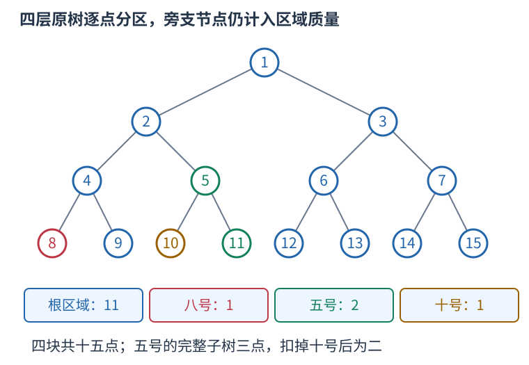

# 操作点分区：完整子树扣掉子区域，压缩后仍维护真实点数

一棵巨大有根树中，只有少量节点会被查询，且删除操作只删这些节点连向父亲的边。没有被操作的整片区域可以合在一起，但权值必须保留真实节点数，不能只数压缩后剩几个点。

## 把树分成互不相交的连通区域

收集全部操作节点并加入根。每个非根收集点的压缩父亲，是它最近的另一个收集祖先。对收集点 u，用 u 的完整子树扣掉每个压缩孩子的完整子树，剩余部分就是 u 的区域。



图中收集点为一、五、八、十。根区域有十一点，八号区域一、五号区域二、十号区域一，合计十五。五号完整子树有三点，但其中十号已单独划走，所以五号区域不能仍记三。

每个原节点归入其最深收集祖先的区域，因此不会重叠或遗漏。区域内一个留下节点到区域根的祖先路径也留下，故区域连通。所有可能删除的边都位于区域之间，区域内部没有会被删除的边，所以可收缩成一个带大小的点。

## 用先序区间找压缩父亲

有根树中，完整子树的先序位置连续。若子树根位置为 begin，大小为 count，它覆盖半开区间 [begin,begin+count)。收集点按 begin 排序，栈中保留尚未结束的嵌套区间。处理新点时，先弹出已经结束的区间，剩余栈顶就是最近收集祖先，再把新点压栈。

以下例子已经给出四层满二叉树中上述点的先序位置与完整子树大小。按先序的顺序是一、八、五、十，并非原编号升序。

```cpp
vector<unsigned long long> begin={1,4,6,7};
vector<unsigned long long> full={15,1,3,1},mass=full;
vector<int> parent(4,-1),stack={0};
for(int i=1;i<4;++i) {
    while(begin[i]>=begin[stack.back()]+full[stack.back()])stack.pop_back();
    parent[i]=stack.back();
    mass[parent[i]]-=full[i];
    stack.push_back(i);
}
for(auto value:mass)cout<<value<<' '; // 11 1 2 1
```

减去的是压缩孩子的完整子树大小，不能减它已经扣掉后代的区域大小，否则孙区域会被错误留在祖先区域里。每个孩子只从自己的压缩父亲减一次，其子树中的后代统一由这次扣除涵盖。

这个收缩只关心连通性和点数。没有单独保留的分叉祖先仍在某个连通区域内，不需要为本任务另行补入 LCA；若要保留任意两点路径距离或虚树路径结构，必须重新证明该压缩是否足够。

## 离线删边改成倒序加边

先建立所有删除完成后的森林，再倒序恢复边。并查集根保存的是各区域 mass 之和，按大小合并的 size 则统计压缩节点数，两者用途不同。查询操作点所在根的 mass，就得到原树的真实连通块大小。

重复删除同一边时，先统计总次数，逆序减到零才恢复；删根忽略。已恢复一条边之后，才会进入这条边在正序中尚未被删的时段。区域构建排序 $O(k\log k)$，栈操作 $O(k)$，存储 $O(k)$，其中 k 为不同收集点数；完整树规模不进入数组长度。
