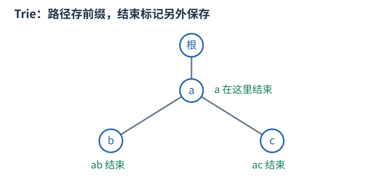

# 字典树：共享相同前缀的分支

要频繁查询一批字符串的前缀，可从根开始，每层用一个字符选一条边。字符串的公共前缀走相同路径，分歧字符才分开；节点表示“已经读过的前缀”，根表示空前缀。

例如插入 `"ab"`、`"ac"`，根到 $a$ 的边共享，$a$ 再连 $b$、$c$。插入 `"a"` 时不能新造另一条 $a$ 路径，只需在已有 $a$ 节点标记单词结束。存在前缀不等于存在完整单词。

对固定小写字母表，一个节点可保存二十六个孩子编号和结束次数；插入长度 $L$ 的串逐字符前进，缺边则建节点，最后增加结束次数。查询同样沿边，时间 $O(L)$。若要数前缀次数，还应在经过的节点累积次数，而不仅标记叶子。

总节点数不超过所有插入串长度之和加一。固定数组实现的空间约为节点数乘字母表大小；大字母表可用映射省空边，但单步查询成本会改变。删除要维护路径上的次数，不能删除仍由别的词共享的节点。

二进制 Trie 将整数从高位到低位插入，查询最大异或时优先走与当前位相反且仍有元素的分支，因为高位收益大于所有低位总和。这里走的是二进制位而非十进制数字；位宽、零和重复元素都须明确定义。
