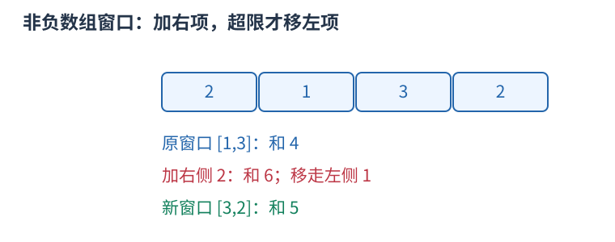

# 双指针与连续窗口：边界为什么能只向前走

当一段区间的合法性随边界移动有可证明的单调变化，可用两个边界维护连续窗口，避免为每个左端点重新扫描右边。

例如数组元素均非负，求和不超过五的最长子段。对 $[2,1,3,2]$，右端依次扩展；加三后总和六，移走左端二后为四；再加二后为六，再移走一后仍为五，窗口成为 $[3,2]$。每次扩展右端，只向右移动左端直到重新合法。



```cpp
int left = 0, best = 0;
long long sum = 0;
for (int right = 0; right < n; ++right) {
    sum += a[right];
    while (left <= right && sum > limit) sum -= a[left++];
    best = max(best, right - left + 1);
}
```

虽然有嵌套循环，左右端各至多移动 $n$ 次，合计为 $O(n)$；维护窗口和用 $O(1)$ 额外空间。证明要数指针总移动次数，不能只看循环嵌套层数。

非负条件使扩展不会降低和，缩短不会增大和。若含负数，当前超限的窗口未来可能因加入负数重新合法，过早丢掉左端可能漏解，需要别的方法。窗口里的最大值也不能像和一样直接相减，要配单调队列等维护结构。

另一类相向双指针在有序数组两端出发，例如找两数和：和太小才移动左边，太大移动右边，依据有序性排除候选。排序会影响原下标和连续性，不能为了套双指针擅自改变题目对象。
