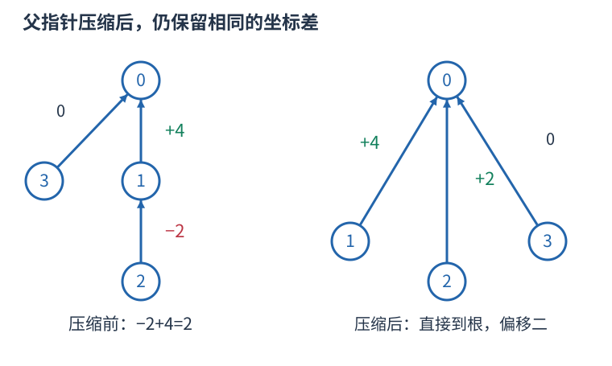

# 带权并查集：保存坐标差，不把代表编号当实际位置

普通并查集只回答两个对象是否同组。如果还给出“y 的坐标减 x 的坐标等于 v”，就要在父指针旁保存差值。坐标可以代表收入前缀、距离或时刻；它们不一定是非负数，也不一定必须知道绝对值。

## 差值沿父链相加

定义 offset[x] 为 X[x]−X[parent[x]]。根指向自己，偏移为零。若二号的父亲是一号，偏移负二，而一号到零号的偏移为四，则二号到零号的偏移是负二加四，等于二。



路径压缩不仅改父亲，也要改偏移。先保存旧父亲，递归使旧父亲到根的偏移算好，再累加到当前点；否则会出现“父亲已是根，偏移却还只到旧父亲”的不一致。

## 两组之间的新差怎样推

压缩 x、y 后，设两根为 A、B，已知 dx=X[x]−X[A]、dy=X[y]−X[B]。要加入 X[y]−X[x]=v，代入得到

$$X[B]-X[A]=v+dx-dy.$$

若 B 挂到 A，就把右侧存到 offset[B]；反向挂接则存相反数。按大小合并时可以任选根的身份，但不能只交换编号而沿用原差的符号。

同根时根坐标抵消，只需检查 dy−dx 是否等于 v。不等说明原约束链与新约束组成矛盾环。不同根时两组原本可独立整体平移，设置根差即可满足约束，不会破坏任一组内部已有关系。

```cpp
#include <bits/stdc++.h>
using namespace std;
struct WeightedDSU {
    vector<int> parent, size;
    vector<long long> offset;
    WeightedDSU(int n):parent(n+1),size(n+1,1),offset(n+1) {
        iota(parent.begin(),parent.end(),0);
    }
    int find(int x) {
        if(parent[x]==x)return x;
        int old=parent[x];
        parent[x]=find(old);
        offset[x]+=offset[old];
        return parent[x];
    }
    bool constrain(int x,int y,long long v) {
        int a=find(x),b=find(y);
        long long difference=v+offset[x]-offset[y];
        if(a==b)return difference==0;
        if(size[a]>=size[b]) {
            parent[b]=a;offset[b]=difference;size[a]+=size[b];
        } else {
            parent[a]=b;offset[a]=-difference;size[b]+=size[a];
        }
        return true;
    }
};
int main() {
    WeightedDSU groups(3);
    groups.constrain(0,3,0);
    groups.constrain(1,2,-2);
    groups.constrain(0,1,4);
    groups.find(2);groups.find(0);
    long long delta=groups.offset[2]-groups.offset[0];
    bool valid=groups.constrain(0,2,2);
    bool conflict=groups.constrain(0,2,3);
    cout<<delta<<' '<<valid<<' '<<conflict<<'\n'; // 2 1 0
}
```

代码下标零到 n 均可使用；负偏移合法。比较两个偏移前先对两个点分别 find，确保它们都已表示到根的差。只有同根才能相减得到确定关系，不同组的偏移各有自己的坐标原点。

普通标量差的合并和路径压缩均为常数次算术操作，按大小合并与路径压缩共同使用时，每次摊还 $O(\alpha(n))$，数组空间 $O(n)$。关系若是异或、模数或其它组合运算，必须重新定义合成与反向规则，不能机械沿用加减公式。
