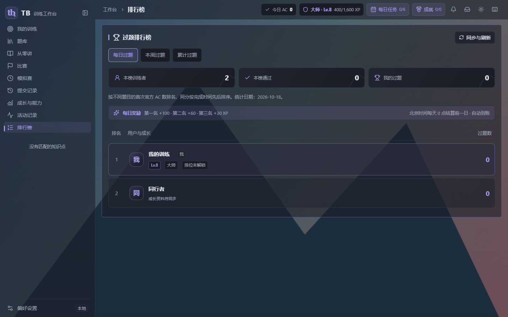

# TB 1.1.2 · 重现赛提交、登录保持与界面修复

2026-10-19 已正式发布。[安装包、便携版、v1.1.1 增量与校验清单](https://github.com/3097729287/acm-algo-trainer/releases/tag/v1.1.2)。

## 重现赛

点击提交与 Ctrl+Enter 均打开原站表单，填入代码、触发一次原生提交并跟踪回执。官方 AC 关联当前重现赛，按受理时间计算通过与罚时；迟到的回执保留，截止后新提交不计入本场。组题模拟赛继续使用本地审核用例，公开样例通过不计作官方 AC。

修复洛谷长题号在选题菜单、赛后记录中的重叠和出框。删除已结束重现赛时，同时移除仅由该重现赛加入的训练项；手动加入、另行练习或其他比赛仍引用的训练保留。草稿、完整提交与 AC 证据继续保留，迟到回执不会重新加入已删除的训练。

## 登录与响应

原站登录使用 TB 专用的持久浏览器配置，记住选用的 Edge/Chrome。额外将该配置中的四站会话以 Windows DPAPI 加密保存在本机 SQLite，重启时补回缺失的有效会话；不读取日常浏览器配置，不上传 Cookie。首次仍需在 TB 弹出的浏览器登录；原站过期或要求验证时由用户完成。

恢复 TB 登录时，若本机快照完整且服务器确认版本未变化，返回小型版本确认，避免重复下载和解压整份学习记录。校验仍要求有效会话，修改与冲突继续合并。

自动保存和回执落库不再每次复制整个个人数据库；普通恢复副本至多每五分钟生成一次，升级、云端替换前仍独立备份。SQLite 写入继续事务提交。在本机 1000 条合成历史、约 16.4 MiB 数据库的对比中，五次保存的中位耗时由 102.11 ms 降至 4.45 ms；这是隔离数据结果，不代表所有设备的启动耗时。

## 界面

- 修复小屏训练操作截断，保留移除与清空入口，点击题目行即可练习。
- 排行榜去掉公开 ID，使用昵称头像、等级、段位与称号；零题用户不显示奖杯。
- 顶部目标、今日 AC 使用统一标签，近七日训练与下一个成就卡片补充实际进度。
- 背景覆盖侧栏、顶部与主要面板，新增 25–100% 面板不透明度；采用静态透明表面，保留清晰的阅读区。

## 共享服务与升级

服务端增加昵称唯一约束：注册与改名都会拒绝已使用的昵称，Unicode 兼容形式、空白与大小写归一后也不能重名。`007_unique_nicknames.sql` 只增加预留表；既有服务先备份，再停 API 执行迁移和 `scripts/migrate-nicknames.mjs`。发现已有冲突时中止，不自动改名。账号、登录号、成绩、会话及数据库卷保留。

本次正式包沿用固定公共内容：5795 题、2215 份题面、960 组默认与详细题解、376 篇讲义。另行进行的题解续写不混入该构建。客户端和共享服务同步协议仍为 1，旧客户端可继续读取完整快照。

验证覆盖重现赛提交与延迟回执、删除训练关联、浏览器重启后的加密会话保持、四站原生表单、昵称并发冲突、SQLite/MySQL 协议、小屏界面和背景透明度。四站提交使用隔离页面；没有向真实账号提交代码。

源码完整检查 477 项通过；共享服务 SQLite 与真实隔离 MySQL 各 27 项通过。原生窗口、全新安装、完整升级、自动更新器重启及 v1.1.1 增量实际应用全部通过。

发布源码为 `bdb24edab3bdfd6f55d14b16560ad31efaca42cd`，标签与构建信息一致。7 个资产共 367,911,215 字节，远端 SHA-256 逐项匹配。本机核对 4530 个程序文件、8 个个人数据库的表与结构和 3 个快捷方式，个人数据保留。共享服务 1.1.2 已在原数据库部署并通过 HTTPS 健康检查。
