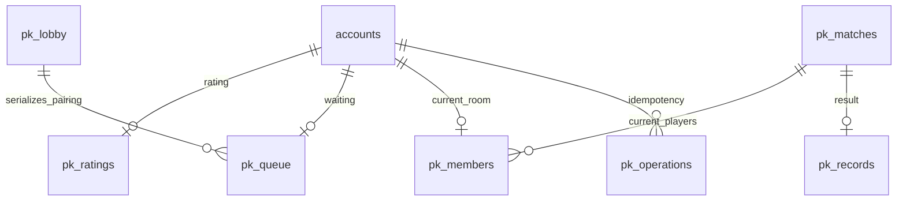

# 思维对决

2026-11-09：独立分支 `finish/thought-20261109` 基于 `5ca1f752` 完成裁判中断恢复、请求总超时、永久配置错误处理及跨账号迟到响应隔离。经用户授权，只读复用 TB 本机加密服务配置，在独立 SQLite／临时账号中完成一次真实 DeepSeek 裁判对局：公开正确算法 99 分、错误算法 39 分，裁判调用 3.350 秒，四次重复交卷只结算一次，重启后答卷、评分与积分完整保留。[无密钥回执](verification/thought-live-provider-20261109.json)。这次本地真实验证没有部署共享服务或制作新桌面包；已发布 1.6.11 应用字节保持不变。

2026-11-04 的历史交付为桌面 1.5.3、服务 1.4.5，017／018 新表及旧数据保全已验证，当时真实裁判未配置、生产匹配关闭。后续是否对玩家开放，以实际部署版本、两个开关与服务端配置为准，不能从本地验证推断。[本轮范围](next-local-release.md)。

用户已确认“逻辑对战”就是同一个“思维对决”模式。对战页顶部提供“排位”和“思维对决”。思维对决使用独立积分与队列：初始 1000 分，匹配时先允许相差 50 分，每等待 15 秒增加 50 分，最多 500 分；题目分数段须相同。排位的原站判题与账号、题库核心接口保持原样。

服务端匹配成功后倒计时 3 秒，随后下发同一道完整题面。双方有固定 15 分钟，用不超过 2000 字的文本说明算法、证明、复杂度和边界。输入自动保存；提交后锁定，单方提前提交仍等待对方或截止时刻。截止时由服务端交出已保存答卷，空白计 0 分。离线不会暂停比赛；尚未传到服务端的修改留在本机按账号和对局隔离的恢复缓存中。多窗口发生版本冲突时，可明确选择保留本机文本或载入服务端文本。

题目池为现有公开题库中的 32 道 800–1500 分题。`scripts/build_thought_problems.py` 只读公开 SQLite，保留原题面、同源译文、限制、参考题解、来源文档与内容摘要；不读个人代码或身份。参考题解只在裁判服务使用，对局中不向玩家发送。赛后可查看双方思路、六维评分和题目分析，最近 20 场从“对局记录”进入；完整记录持续保存在服务数据库。

## 裁判和积分

裁判接口在服务端配置，密钥不进入桌面、前端或日志。System Prompt 固定六项标准：正确性 40、复杂度 20、边界与反例 15、常数与工程可行性 10、表达清晰 10、创新 5。选手文本作为 JSON 中的独立不可信数据，不能成为系统指令。

服务端校验 JSON、布尔值、每项分数、总分与文本长度。算法正确且不超时的最终分至少 60；算法错误或不可行至多 60。空白答卷强制为 0。胜负由服务端依次比较总分、正确性和复杂度决定，不使用提交速度，也不信任模型给出的 winner。网络、408／429／5xx、无效 JSON 等暂时失败，首次调用后最多再重试三次；401／403／无效端点等永久请求错误只尝试一次。失败按平局保存，双方积分不变，不展示伪造的评分。日志仅记录错误代码、数字 HTTP 状态、对局编号与次数，不记录密钥、请求正文、提供商响应正文或答卷。积分使用 K=40 的 Elo；双方同分时胜负通常为 +20/-20，平局不变。胜者至少加 1 分；败者最低 0 分，但余额不足不削减胜者收益，例如双方 0 分时胜者仍加 20 分、败者保持 0。普通结算零和，零分保护差额除外。

## 存储和状态

MySQL `017_thought_duels.sql` 仅幂等新增 `pk_` 表，不重命名、删改原表或原有记录。队列存在数据库中，以一行事务锁串行配对；服务重启不会丢失对局、已保存文本或积分。裁判调用在事务之外异步执行，持久租约和随机令牌防止重复结算及过期工作覆盖新结果。每份修改使用答卷 revision；写请求使用 requestId 去重。本次 `021_thought_judge_budget.sql` 仅新增服务级 `pk_judge_usage` 日计数表，重跑不清零，不修改账号、积分、奖励或答卷表的旧记录。

每次裁判调用的 45 秒总期限同时覆盖连接和读取响应正文；即使传输层忽略取消，业务调用仍会结束。响应最多 128 KiB。服务正常关闭时中断在途裁判，保留锁定答卷、释放自己的租约；新实例可恢复未完成结算。进程崩溃则由 60 秒租约到期后接管；旧调用迟到不能覆盖新实例的裁决或重复加减积分。Python 中转校验请求前后的账号、服务端点和会话 token；React 对局记录也按当前账号和 API 实例丢弃迟到响应。

计费调用还受全服务持久预算限制：`PK_AI_MATCH_CALL_LIMIT` 默认为每场 4 次，可设为 1–4；`PK_AI_DAILY_CALL_LIMIT` 默认为北京时间每天 100 次，可设为 1–10000。每次调用之前，在同一个 `pk_lobby` 事务锁内原子增加日计数；跨进程共享，失败、取消和重启均不退还已占额度。每个进程同时最多 2 个裁判任务，每次输出最多 6000 tokens；`PK_AI_TIMEOUT_MS` 可收紧到 1–45000 毫秒。日预算属于整个共享服务，多实例必须使用相同配置，不是每个玩家各有一份。

日额度耗尽时停止新匹配。已锁定的答卷保持 `judging`，不生成裁决、赛果或积分变动；`match.judgingWait` 携带原因和下一次检查时间，每 60 秒检查一次，审核提高额度或北京时间跨日后自动继续。React 使用原来的裁判进度区域显示“答卷已保留，等待裁判恢复”。021 尚未执行时也停止新增调用，已有记录仍可读取。单场暂时故障达到调用上限后的显式失败平局，和额度不足时保留待处理状态，是两种不同结果。



状态依次为 `idle → queued → countdown → active → judging → finished`，结束后手动返回匹配。队列心跳过期只退出队列；对局中掉线不会自动判负。服务进程每秒推进计时；客户端沿用现有 HTTP 轮询并校准服务时钟。

## API 和事件

所有接口复用既有账号 Bearer 会话。桌面仅中转到共享服务，不参与选题、计时、AI 调用或结算；本机写请求继续检查 Origin 与会话 token。错误使用 `PK_` 代码。

| 接口 | 方法 | 内容 |
| --- | --- | --- |
| `/api/pk/v1/state` | GET | 本人状态、服务时钟、功能开关 |
| `/api/pk/v1/match/join` | POST | requestId、minDifficulty、maxDifficulty |
| `/api/pk/v1/match/cancel` | POST | requestId、ticket |
| `/api/pk/v1/game/poll` | POST | 空 JSON；心跳及事件投影 |
| `/api/pk/v1/game/draft` | POST | requestId、matchId、revision、text |
| `/api/pk/v1/game/submit` | POST | 同上；确认后锁定 |
| `/api/pk/v1/game/dismiss` | POST | requestId、matchId |
| `/api/pk/v1/history` | GET | 本人最近 20 场摘要 |
| `/api/pk/v1/history/:id` | GET | 本人参与过的已结束对局 |

房间携带有序事件 `pk:match_success`、`pk:game_start`、`pk:opponent_submitted`、`pk:judging`、`pk:game_over`。事件与快照共同恢复，重复轮询不重复提交。对局结束前只暴露对方是否交卷，不暴露对方正文；倒计时阶段隐藏题目。第三个账号不能读取别人的对局记录。

## 配置和回退

新功能默认关闭：`PK_MATCH_ENABLED=0`、`PK_THOUGHT_MODE_ENABLED=0`。旧服务没有新接口时桌面显示“思维对决服务尚未启用”，排位照常使用。本分支沿用当前服务与桌面的版本号；本次不自动部署生产服务或公开发布安装包。

部署前先备份并核验现有服务数据库，完成 MySQL 恢复演练和原表保全核对，再幂等执行必要的 017 与新增 021。已有实例不依赖 Docker 首次初始化自动补迁移。将裁判密钥写入服务端 `secrets/pk_ai_key`，配置完整的 HTTPS Chat Completions 端点 `PK_AI_ENDPOINT` 和模型 `PK_AI_MODEL`。不要把密钥写进命令行、Git 或客户端设置。[部署交接](verification/thought-finish-handoff-20261109.md) 列出具体文件、字段与只传 stdin 的复用入口。

需要启用时显式叠加 `compose.pk.yaml`，将两个开关均设为 1。`PK_AI_KEY_FILE` 默认指向容器 secret；无密钥、无模型或无端点时仍不能加入队列。端点必须是完整 HTTPS `/chat/completions` 路径，不能包含 URL 凭据、查询参数或片段。DeepSeek／火山／Qwen 非思考选项沿用桌面翻译服务的配置规则。必须在实际服务环境验证真实提供商返回、超时与额度后再开放给玩家。本机已授权真实验证只证明所记载的单个公开用例；离线 UI 的 fixture 裁判仍不属于真实提供商测试。

生产入口为 `server/leaderboard/src/server.mjs` 的 `PK_AI_ENDPOINT`、`PK_AI_MODEL`、`PK_AI_KEY_FILE`（或 `PK_AI_KEY`），两项开关须同时开启。桌面现有翻译配置属于个人本机配置，不自动同步、上传或配置到共享服务。经用户本次授权复用的本地位置是普通程序 `state/tb-documents.sqlite3` 中 `documents` 表的 `translation-settings.json`：所需字段为 `provider`、`model`、`baseUrl`、DPAPI `protectedKey`。本轮只读此行、仅在内存解密后通过 stdin 传给隔离工具；不读取 `.dsh` 等其他项目凭据，也不改普通配置。

回退时先关闭两个开关，保留所有 `pk_` 表和记录，再切回先前服务构建与桌面构建。已开始的对局仍按服务时间结束；未配置裁判时以平局结算。不要为回滚删除个人答卷、记录或积分表。

## 检查命令

```text
python scripts/check.py
cd server/leaderboard
npm test
cd ../../frontend
npm run build
npm run test:thought-duel
node tests/gameplay-owner-races.mjs
```

本轮已通过思维对决 React 专项、前端构建、25 项裁判／恢复专项、29 项 Python 中转／账号相关测试，以及共享服务 159 项中的 157 项；两项明确跳过，其中新增的 MySQL 原子计数／幂等迁移验收需要 `TB_MYSQL_TEST_PORT` 指向独立测试库。旧 `gameplay-owner-races.mjs` 的贴纸 fixture 因找不到既有“贴纸”按钮失败，本轮没有修改该通用贴纸用例或贴纸产品，也不将它列为通过。

真实提供商验收必须显式允许一次计费调用，工具不自动查找任何本机密钥。将 `{provider, endpoint, model, key}` 通过受保护 stdin 提供给下列命令；不得将真实 JSON 写入 Git、命令行或回执文件。每个新的回执路径只能执行一次，最多一次提供商请求，出错也不自动增加预算。它使用生产裁判与共享 HTTP 处理、独立 SQLite 和临时账号，检查草稿恢复、评分、重复交卷、记录隐私和重启后的结算持久化；SQLite 是测试存储适配器，不冒充已在生产 MySQL 上部署。

```text
cd server/leaderboard
node scripts/verify-thought-provider.mjs --allow-paid-call --output ../../.backups/NEW_CASE/result.json
```

桌面交付还要求隔离新装与从当前版本升级、已提交 WAL 和原身份/草稿保全，以及两版正常入口检查。管理员产物仅本机保存。变更与验证回执记录在本机当前更新说明，不将候选或隔离裁判写成生产可用。
