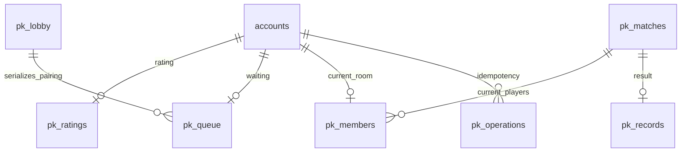

# 思维对决

对战页顶部提供“排位”和“思维对决”。思维对决使用独立积分与队列：初始 1000 分，匹配时先允许相差 50 分，每等待 15 秒增加 50 分，最多 500 分；题目分数段须相同。排位的原站判题与账号、题库核心接口保持原样。

服务端匹配成功后倒计时 3 秒，随后下发同一道完整题面。双方有固定 15 分钟，用不超过 2000 字的文本说明算法、证明、复杂度和边界。输入自动保存；提交后锁定，单方提前提交仍等待对方或截止时刻。截止时由服务端交出已保存答卷，空白计 0 分。离线不会暂停比赛；尚未传到服务端的修改留在本机按账号和对局隔离的恢复缓存中。多窗口发生版本冲突时，可明确选择保留本机文本或载入服务端文本。

题目池为现有公开题库中的 32 道 800–1500 分题。`scripts/build_thought_problems.py` 只读公开 SQLite，保留原题面、同源译文、限制、参考题解、来源文档与内容摘要；不读个人代码或身份。参考题解只在裁判服务使用，对局中不向玩家发送。赛后可查看双方思路、六维评分和题目分析，最近 20 场从“对局记录”进入；完整记录持续保存在服务数据库。

## 裁判和积分

裁判接口在服务端配置，密钥不进入桌面、前端或日志。System Prompt 固定六项标准：正确性 40、复杂度 20、边界与反例 15、常数与工程可行性 10、表达清晰 10、创新 5。选手文本作为 JSON 中的独立不可信数据，不能成为系统指令。

服务端校验 JSON、布尔值、每项分数、总分与文本长度。算法正确且不超时的最终分至少 60；算法错误或不可行至多 60。空白答卷强制为 0。胜负由服务端依次比较总分、正确性和复杂度决定，不使用提交速度，也不信任模型给出的 winner。首次调用失败最多再重试三次；仍失败按平局保存，双方积分不变，不展示伪造的评分。积分使用 K=40 的 Elo；双方同分时胜负通常为 +20/-20，平局不变，最低 0 分。

## 存储和状态

MySQL `017_thought_duels.sql` 仅幂等新增 `pk_` 表，不重命名、删改原表或原有记录。队列存在数据库中，以一行事务锁串行配对；服务重启不会丢失对局、已保存文本或积分。裁判调用在事务之外异步执行，持久租约和随机令牌防止重复结算及过期工作覆盖新结果。每份修改使用答卷 revision；写请求使用 requestId 去重。



状态依次为 `idle → queued → countdown → active → judging → finished`，结束后手动返回匹配。队列心跳过期只退出队列；对局中掉线不会自动判负。服务进程每秒推进计时；客户端沿用现有 HTTP 轮询并校准服务时钟。

## API 和事件

所有接口复用既有账号 Bearer 会话。桌面仅中转到共享服务，不参与选题、计时、AI 调用或结算；本机写请求继续检查 Origin 与会话 token。错误使用 `PK_` 代码。

| 接口 | 方法 | 内容 |
| --- | --- | --- |
| `/api/pk/v1/state` | GET | 本人状态、服务时钟、功能开关 |
| `/api/pk/v1/match/join` | POST | requestId、minDifficulty、maxDifficulty |
| `/api/pk/v1/match/cancel` | POST | requestId、ticket |
| `/api/pk/v1/game/poll` | POST | 空 JSON；心跳及事件投影 |
| `/api/pk/v1/game/draft` | POST | requestId、matchId、revision、text |
| `/api/pk/v1/game/submit` | POST | 同上；确认后锁定 |
| `/api/pk/v1/game/dismiss` | POST | requestId、matchId |
| `/api/pk/v1/history` | GET | 本人最近 20 场摘要 |
| `/api/pk/v1/history/:id` | GET | 本人参与过的已结束对局 |

房间携带有序事件 `pk:match_success`、`pk:game_start`、`pk:opponent_submitted`、`pk:judging`、`pk:game_over`。事件与快照共同恢复，重复轮询不重复提交。对局结束前只暴露对方是否交卷，不暴露对方正文；倒计时阶段隐藏题目。第三个账号不能读取别人的对局记录。

## 配置和回退

新功能默认关闭：`PK_MATCH_ENABLED=0`、`PK_THOUGHT_MODE_ENABLED=0`。旧服务没有新接口时桌面显示“思维对决服务尚未启用”，排位照常使用。服务候选为 1.4.3；桌面为 1.5.3，本次不自动部署生产服务或公开发布安装包。

部署前先备份并核验现有服务数据库，完成 MySQL 恢复演练和原表保全核对，再幂等执行 017。已有实例不依赖 Docker 首次初始化自动补迁移。将裁判密钥写入服务端 `secrets/pk_ai_key`，配置完整的 HTTPS Chat Completions 端点 `PK_AI_ENDPOINT` 和模型 `PK_AI_MODEL`。不要把密钥写进命令行、Git 或客户端设置。

需要启用时显式叠加 `compose.pk.yaml`，将两个开关均设为 1。`PK_AI_KEY_FILE` 默认指向容器 secret；无密钥、无模型或无端点时仍不能加入队列。必须验证真实提供商返回、超时与额度后再开放给玩家。本次隔离测试中的模型回执不代表真实提供商成功。

回退时先关闭两个开关，保留所有 `pk_` 表和记录，再切回先前服务构建与桌面构建。已开始的对局仍按服务时间结束；未配置裁判时以平局结算。不要为回滚删除个人答卷、记录或积分表。

## 检查命令

```text
python scripts/check.py
cd server/leaderboard
npm test
cd ../../frontend
npm run build
npm run test:thought-duel
node tests/gameplay-owner-races.mjs
```

桌面交付还要求隔离新装与从当前版本升级、已提交 WAL 和原身份/草稿保全，以及两版正常入口检查。管理员产物仅本机保存。变更与验证回执记录在本机当前更新说明，不将候选或隔离裁判写成生产可用。
